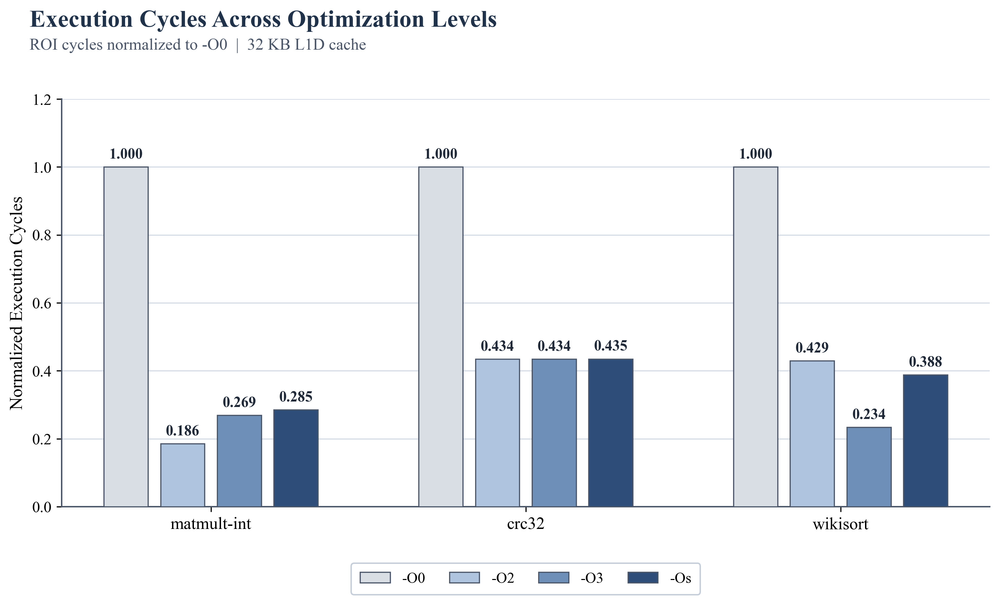
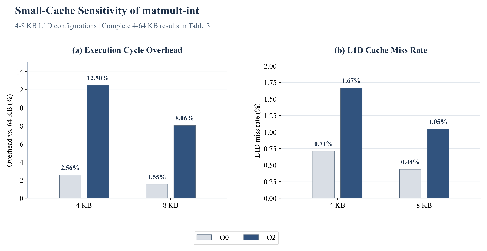

# RISC-V Compiler Optimization and Cache Performance

This project examines how GCC optimization levels and L1 data cache capacity affect the execution of RISC-V programs. Three Embench-IoT workloads were evaluated using gem5, with performance compared through execution cycles, instruction counts, IPC, CPI, cache miss rates, and code size.

The experiments include 36 compiler/cache configurations, four additional small-cache tests, and a RISC-V assembly comparison to investigate an unexpected performance regression at `-O3`.

## Experimental Setup

| Parameter | Configuration |
|---|---|
| Simulator | gem5 23.0.0.1 |
| ISA | RV64GC |
| CPU | RiscvTimingSimpleCPU, 1 GHz |
| Simulation mode | Syscall Emulation (SE) |
| Benchmarks | matmult-int, crc32, wikisort |
| GCC optimization | -O0, -O2, -O3, -Os |
| L1 instruction cache | 32 KB, 4-way |
| L1 data cache | 16, 32, 64 KB |
| Additional cache tests | 4 and 8 KB |
| Cache line size | 64 bytes |
| L2 cache | None |
| Memory | 512 MB address range |

The main experiment covers three benchmarks, four optimization levels, and three L1D cache sizes (36 runs). Four additional runs examine matmult-int at 4 and 8 KB under `-O0` and `-O2`.

Statistics were collected within a region of interest (ROI) using gem5's `m5_reset_stats()` and `m5_dump_stats()` operations, excluding benchmark initialization and the preceding warm-up phase.

## Results

### Compiler Optimization

At a fixed 32 KB L1D cache, the best compiler setting varied by workload.

| Benchmark | Best optimization | Cycle reduction vs. -O0 |
|---|---|---:|
| matmult-int | -O2 | 81.43% |
| crc32 | -O3 | 56.56% |
| wikisort | -O3 | 76.62% |



For matmult-int, `-O3` increased execution cycles by 45.01% relative to `-O2`, despite being a more aggressive optimization setting.

Instruction count helps explain the difference: `-O3` executed 36.75% more instructions and had a 6.04% higher CPI. Disassembly showed differences in loop organization, function inlining, and result-element updates. These observations are consistent with the regression but do not isolate the cost of individual compiler transformations.

The `-Os` setting produced the smallest `.text` section for all three benchmarks, although it was not the fastest configuration. This illustrates the trade-off between code footprint and execution performance.

### Cache Performance

Increasing the L1D cache from 16 to 64 KB had little effect on the measured execution cycles. For matmult-int, the largest reduction was approximately 0.013%; crc32 and wikisort showed no measurable cycle difference.

The additional tests revealed more substantial penalties at smaller cache capacities.



For matmult-int at `-O2`, a 4 KB L1D cache increased execution cycles by 12.50% relative to 64 KB. The overhead decreased to 8.06% at 8 KB. Higher miss rates at smaller capacities were consistent with these performance changes.

The full cache sensitivity data is available in [Table 3](results/processed/table3_cache_sensitivity.csv).

### Assembly Analysis

The `-O2` and `-O3` versions of matmult-int were compared at the RISC-V assembly level.

- [Assembly analysis summary](analysis/assembly/analysis_summary.md)
- [matmult-int at -O2](analysis/assembly/matmult_O2.asm)
- [matmult-int at -O3](analysis/assembly/matmult_O3.asm)

## Figures and Data

The repository includes all eight final figures in both PNG and PDF formats.

| Figure | Analysis |
|---|---|
| [1](results/figures/figure1_compiler_cycles.png) | Compiler optimization vs. execution cycles |
| [2](results/figures/figure2_compiler_ipc.png) | Instructions per cycle |
| [3](results/figures/figure3_compiler_instructions.png) | Dynamic instruction count |
| [4](results/figures/figure4_compiler_code_size.png) | Code size |
| [5](results/figures/figure5_cache_cycles.png) | L1D cache size vs. execution cycles |
| [6](results/figures/figure6_cache_miss_rate.png) | L1D cache miss rates |
| [7](results/figures/figure7_compiler_cache_heatmap.png) | Compiler/cache performance comparison |
| [8](results/figures/figure8_cache_sensitivity.png) | Small-cache sensitivity |

Raw gem5 statistics and configuration files are under `results/raw/`. Verified CSV results and summary tables are under `results/processed/`.

## Scripts and Reproduction

Python dependencies are listed in `requirements.txt`.

To verify the main experiment metrics against the preserved gem5 statistics:

```bash
python3 scripts/verify_results.py
```

To regenerate the seven main-analysis figures, two tables, and results summary:

```bash
python3 scripts/generate_final_results.py
```

Regenerated output is saved under `results/regenerated/`, separate from the original results.

The repository also includes `scripts/extract_roi_results.py` for extracting statistics using an existing RISC-V binary build directory and `scripts/run_gem5.sh` for launching individual simulations.

The original 40 simulation outputs are preserved. The main data extraction, analysis, and verification scripts have been tested. Full reproduction from Embench source still requires the matching cross-compiler, build configuration, and gem5 environment; the original build information and remaining limitations are documented in [build notes](docs/build_notes.md).

## Limitations

These measurements apply to three Embench-IoT workloads and one simulated RISC-V CPU configuration. The additional small-cache tests cover only matmult-int at two optimization levels. Results should not be interpreted as general performance rankings for all RISC-V processors or embedded applications.
